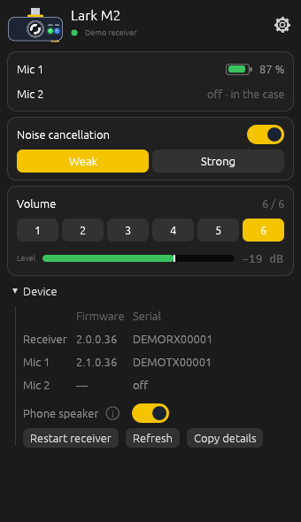
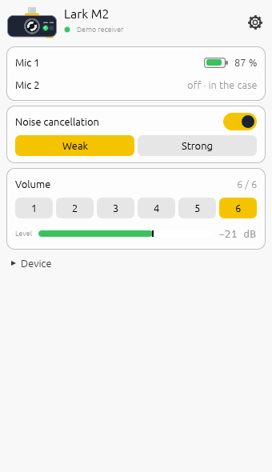
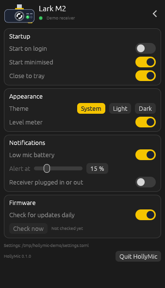
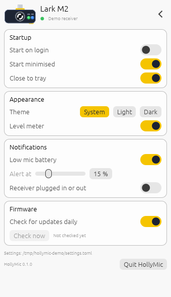
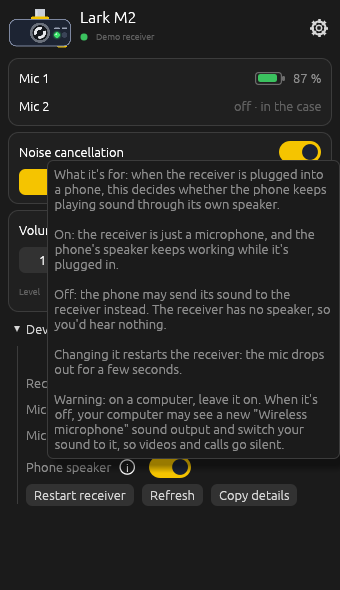

# HollyMic

A small tray app for the **Hollyland Lark M2** wireless mic on **Linux** and **macOS**. It does what Hollyland's HollyAudio phone app does for the Lark M2, from your desktop: battery, noise cancellation, volume and the firmware check, without unplugging the receiver and moving it to a phone.

The tray icon is the USB-C receiver's body with its two lights, one per mic slot, lit the way the receiver's own LEDs are (the window shows the whole receiver, plug and all):


| Light | Means |
|---|---|
| 🟢 green | a mic is connected on that slot, noise cancellation **on** |
| 🔵 blue | a mic is connected on that slot, noise cancellation **off** |
| 🔵 flashing blue | no mic connected on that slot (it's off or in the case) |
| none, faded dongle | no receiver plugged in |

From left: no receiver, no mics, mic 1 with noise cancellation, both, mic 1 without, both. Settings can stop the flashing. Hover for battery levels; click to open the window; right-click for quick controls.

| Dark | Light |
|---|---|
|  |  |
|  |  |

*Screenshots use the built-in demo receiver (`hollymic --demo`).*

<details><summary>What "Phone speaker" does (the ⓘ next to it)</summary>



</details>

HollyMic is unofficial and not affiliated with Hollyland. It's for the Lark M2 only: not the M2S, A2, M3, MAX or Hollyland's speakers.

## Install

```bash
curl -fsSL https://raw.githubusercontent.com/rj-xy/hollymic/main/install.sh | bash
```

It installs to `~/.local/bin/hollymic` with an app-menu entry (Linux) or `~/Applications/HollyMic.app` (macOS). No root, except once on Linux: a udev rule so your user can talk to the receiver (it asks for your password; `--no-udev` skips it).

> 🟠 **Before the first release:** the one-liner can't download yet. Build or get a `hollymic-<version>-<os>-<arch>.tar.gz`, then run `bash install.sh` next to it (or `--file <tarball>`). It also looks in `~/Downloads`.

### Update

Run the same command again. It stops HollyMic, replaces it, and starts it again if it was running.

```bash
curl -fsSL https://raw.githubusercontent.com/rj-xy/hollymic/main/install.sh | bash
```

### Uninstall

Keeps your settings:

```bash
curl -fsSL https://raw.githubusercontent.com/rj-xy/hollymic/main/install.sh | bash -s -- --uninstall
```

Removes the settings too:

```bash
curl -fsSL https://raw.githubusercontent.com/rj-xy/hollymic/main/install.sh | bash -s -- --uninstall --purge
```

## What it does

| HollyAudio (Lark M2 screen) | HollyMic |
|---|---|
| Mic connected, battery per mic | ✅ tray tooltip, menu and window; low-battery notification |
| Noise cancellation on/off | ✅ needs receiver firmware newer than 2.0.0.31 |
| Noise cancellation level: Weak / Strong | ✅ |
| Volume 1–6 | ✅ |
| Volume lock | ✅ camera receivers only, like the app (untested: no camera receiver here) |
| Phone speaker | ✅ restarts the receiver to apply, like the app. Its ⓘ (hover or click) explains it; on a computer, leave it on |
| Input level meter | ✅ Linux (reads the mic through PipeWire) |
| Firmware versions and serial numbers | ✅ |
| Firmware update check | ✅ asks Hollyland's server daily and tells you; no serial numbers sent |
| Firmware update | ❌ on purpose: a failed flash can brick the mic. Use HollyAudio or Hollyland's LarkM2Upgrade |
| Restart receiver | ✅ |
| Account, presets, manuals, feedback | ❌ not for the Lark M2 or not useful on a desktop |

Settings (saved in `~/.config/hollymic/settings.toml`, or `~/Library/Application Support/hollymic/` on macOS): start on login, start minimised, close to tray, theme (system, light, dark), flashing tray light for empty slots, level meter, low-battery alert and threshold, plug-in/out notifications, daily firmware check.

The mic keeps working in every app while HollyMic runs: it only takes the receiver's control interface, not the audio.

## Command line

```bash
hollymic status --short      # mic1 87% · mic2 off · nc weak · volume 6/6
hollymic nc on|off|weak|strong
hollymic volume 1-6
hollymic firmware            # check for newer firmware now
hollymic show | settings | quit
```

They talk to the running app, or to the receiver directly when it isn't running. Handy for keyboard shortcuts. `hollymic --help` lists everything.

## Linux permissions

The kernel drops the receiver's replies on its HID device, so HollyMic reads it over USB directly (interface 0 only; audio stays with the sound driver). Your user needs access to the USB device node. The installer adds `/etc/udev/rules.d/70-hollymic.rules`; to add it by hand:

```bash
sudo cp packaging/70-hollymic.rules /etc/udev/rules.d/ && sudo udevadm control --reload && sudo udevadm trigger
```

Then unplug and replug the receiver. Plug it into a USB-C port that carries data: on a charge-only port it lights up but the computer can't see it.

The tray uses StatusNotifierItem: built into KDE Plasma, Xfce, Cinnamon and most others. On GNOME install the AppIndicator extension. Without a tray, HollyMic runs as a normal window.

## macOS

🔴 Not working yet. It builds, but macOS drops the receiver's replies, and the only way around that (taking the whole USB device as root) also stops the mic's audio while HollyMic holds it. See [docs/WIP.md](docs/WIP.md#macos).

## Build

Rust 1.88 or newer.

```bash
cargo build --release
./target/release/hollymic --demo     # try it without a receiver
scripts/package.sh                   # dist/hollymic-<version>-<os>-<arch>.tar.gz
```

## Thanks

The USB protocol notes come from [khromov/hollyland-web-ui](https://github.com/khromov/hollyland-web-ui), which reverse-engineered HollyAudio for its WebHID page. HollyMic re-checked them against HollyAudio 3.1.0 for Android and a real Lark M2. Details: [docs/PROTOCOL.md](docs/PROTOCOL.md).

## Licence

MIT, see [LICENSE](LICENSE).
